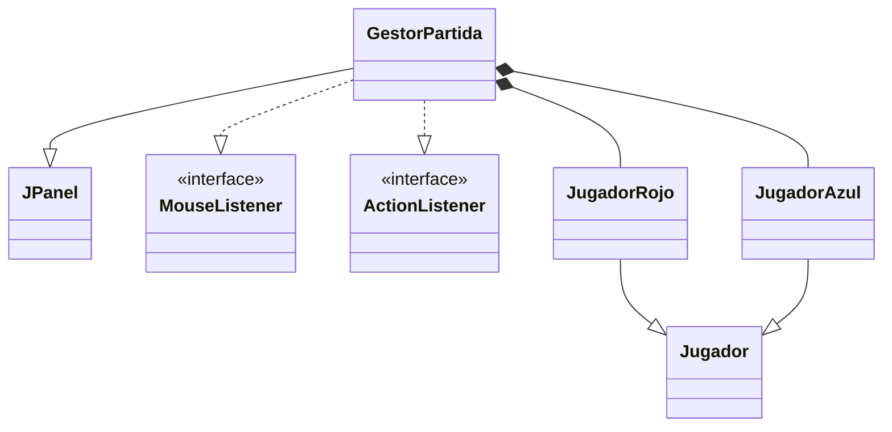
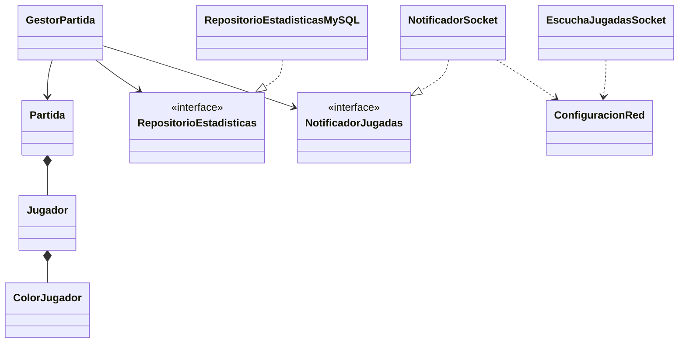

# Ejercicio 5 · Refactoriza el GestorPartida

Arquitectura de Software · Unidad II · ITSON
Individual · Entrega sugerida: semana 4

Este proyecto es un Parchís para dos jugadores, rojo y azul, en una sola computadora. La versión inicial concentraba en `GestorPartida` la interfaz, las reglas, la red y MySQL. El código está refactorizado para separar esas responsabilidades:

- `GestorPartida` coordina la interfaz Swing y delega las reglas a `Partida`.
- `Partida` mantiene el estado y aplica las reglas de movimiento, captura, turnos y victoria.
- `RepositorioEstadisticas` y `NotificadorJugadas` son interfaces; MySQL y sockets son adaptadores intercambiables.
- `ColorJugador` centraliza nombre, casilla de salida y color visual.
- `Jugador` contiene un color en lugar de requerir subclases por cada color.

## Qué hacer

Refactoriza el código aplicando los cuatro principios de la sección:

- una sola responsabilidad;
- no te repitas (DRY);
- composición sobre herencia;
- diseñar orientado a la interfaz.

El juego debe seguir funcionando igual que antes del cambio.

## Qué se entrega

1. El diagrama de clases de antes y el de después, en StarUML, indicando qué principio aplica cada cambio.
2. El código de al menos dos de las clases resultantes, en tu repositorio.

## Principios aplicados en el código

- **Responsabilidad única:** `Partida` gestiona reglas y estado; `GestorPartida` la interfaz; `RepositorioEstadisticasMySQL` la persistencia; y `NotificadorSocket` el envío de jugadas.
- **DRY:** `ColorJugador` evita repetir los atributos y decisiones asociados a los colores.
- **Composición sobre herencia:** `Jugador` recibe un `ColorJugador`; se eliminaron `JugadorRojo` y `JugadorAzul`.
- **Orientación a interfaces:** `GestorPartida` depende de `RepositorioEstadisticas` y `NotificadorJugadas`, no de sus detalles concretos.

### Estructura inicial

### Estructura refactorizada

El siguiente esquema muestra las relaciones principales para trasladarlas al diagrama de StarUML:

## Cómo correrlo

1. En NetBeans: **File › Open Project** y elige esta carpeta.
2. **Run**. Se abre el tablero; rojo y azul juegan por turnos en la misma ventana.

Reglas:

- Con 5 se saca una ficha de la base.
- Si una ficha cae en una ficha rival, la rival regresa a su base.
- Con 6 se vuelve a tirar, máximo tres veces seguidas.
- Para entrar a la meta se necesita el número exacto.
- Gana quien lleva primero sus cuatro fichas a la meta.

## La red y la base de datos (opcional)

El juego funciona sin red y sin MySQL: lo anota en la bitácora y sigue.

- **Red.** Cada jugada se envía a `localhost:5000`. Para ver cómo llegan, corre una segunda copia en modo espectador: en NetBeans, **Properties › Run › Arguments** con el valor `espectador`, y luego **Run**. Las jugadas aparecen en la ventana Output. El host y puerto se definen en `ConfiguracionRed`.
- **MySQL.** Con un servidor en `localhost:3306`, la base `parchis` y la tabla `estadisticas` se crean solas. Ajusta `URL_BD`, `USUARIO_BD` y `CLAVE_BD` en `RepositorioEstadisticasMySQL` con los datos de tu servidor.
